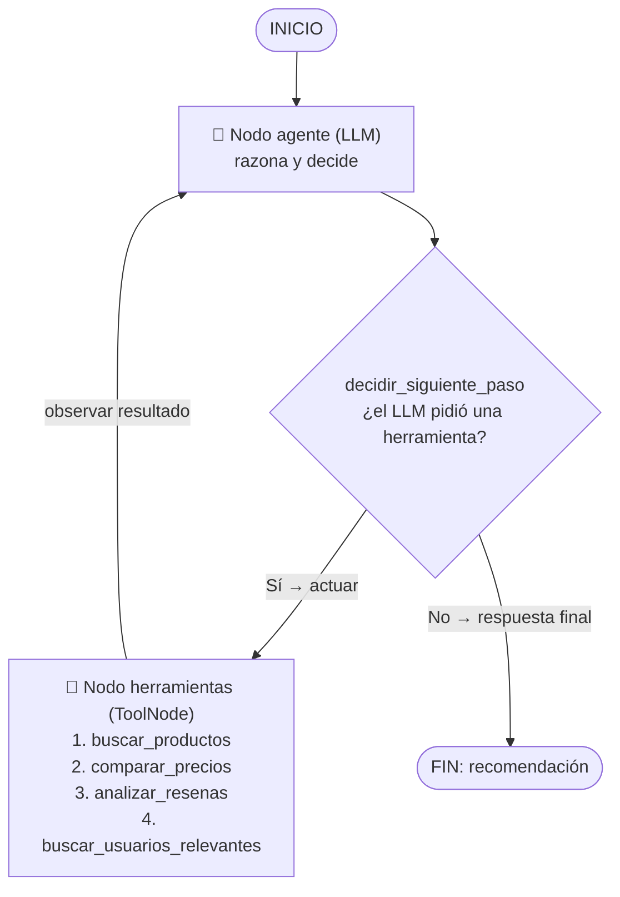
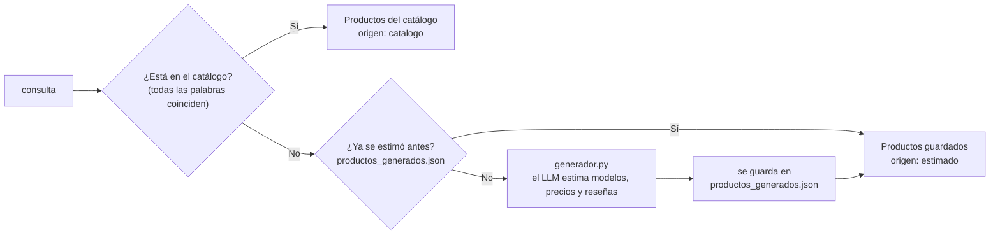

# Arquitectura del Agente para Compras Inteligentes

## 1. Visión general

El sistema es **un solo agente** construido con **LangGraph**. El agente tiene un "cerebro" (un LLM: gpt-oss-120b en Groq, o Llama local con Ollama) y **4 herramientas**. En cada paso el LLM **razona** qué hacer: decide si necesita usar una herramienta o si ya puede dar la respuesta final. Este ciclo se conoce como el patrón **ReAct** (*Reasoning + Acting*):

> **Razonar** (el LLM piensa) → **Actuar** (ejecuta una herramienta) → **Observar** (lee el resultado) → vuelve a razonar… → **Respuesta final**

```
Usuario ──► app.py (Streamlit) ──► agente.py (grafo LangGraph) ──► herramientas/ ──► datos.py
                                                                                      ├─► data/productos_mock.json (catálogo)
                                                                                      └─► generador.py (LLM estima si no está)
                  ▲                         │
                  └──── pasos y resultados ─┘
```

---

## 2. Diagrama del grafo



El grafo tiene solo **2 nodos y 1 condición**:

| Elemento | En el código (`agente.py`) | Qué hace |
|---|---|---|
| Nodo **agente** | `nodo_agente` | Envía al LLM las instrucciones y toda la conversación. El LLM responde con una petición de herramienta (`tool_calls`) o con la respuesta final. |
| Nodo **herramientas** | `ToolNode(HERRAMIENTAS)` | Ejecuta la herramienta que pidió el LLM y agrega el resultado al estado (`ToolMessage`). |
| **Condición** | `decidir_siguiente_paso` | Si el último mensaje del LLM trae `tool_calls`, va a **herramientas**. Si no, termina (**END**). |
| Aristas fijas | `START → agente` y `herramientas → agente` | Siempre se empieza razonando, y después de cada herramienta se vuelve a razonar. |

---

## 3. El estado del grafo (`estado.py`)

```python
class EstadoAgente(TypedDict):
    messages: Annotated[list[AnyMessage], add_messages]
```

El estado es **una sola lista de mensajes**. Es la "memoria de trabajo" del agente durante una consulta.

**Cómo fluye el estado** en una consulta de "audífonos inalámbricos":

| Paso | Nodo | Mensaje que se **agrega** a `messages` |
|---|---|---|
| 0 | (inicio) | `HumanMessage`: "audífonos inalámbricos" |
| 1 | agente | `AIMessage` con `tool_calls = [buscar_productos(...)]` |
| 2 | herramientas | `ToolMessage` con las opciones de cada tienda (JSON) |
| 3 | agente | `AIMessage` con `tool_calls = [comparar_precios(...)]` |
| 4 | herramientas | `ToolMessage` con el precio final, el promedio y el rango |
| 5 | agente | `AIMessage` con `tool_calls = [analizar_resenas(...)]` |
| 6 | herramientas | `ToolMessage` con los scores y las reseñas |
| 7 | agente | `AIMessage` con `tool_calls = [buscar_usuarios_relevantes(...)]` |
| 8 | herramientas | `ToolMessage` con las personalidades |
| 9 | agente | `AIMessage` **sin** `tool_calls` → recomendación final → **FIN** |

**¿Por qué `add_messages`?** Es un *reductor*: cuando un nodo devuelve `{"messages": [nuevo]}`, LangGraph **agrega** ese mensaje a la lista en lugar de reemplazarla. Así el LLM siempre ve todo lo que ha observado.

> Nota: el LLM puede pedir varias herramientas en un solo paso. `ToolNode` las ejecuta todas y el flujo sigue igual.

---

## 4. Las herramientas

Todas viven en `herramientas/` y se definen con el decorador `@tool` de LangChain. El **docstring** de cada herramienta es lo que lee el LLM para saber **cuándo** usarla. Todas reciben un único parámetro, `consulta` (lo que busca el usuario), y devuelven **texto JSON**. Así el LLM las puede leer y el front end puede armar tablas con los mismos datos.

Las 4 comparten `herramientas/datos.py` (ver sección 5), que primero busca en el catálogo por palabras clave:
1. Pasa la consulta a minúsculas y le quita los acentos ("Audífonos" → "audifonos").
2. Quita las palabras vacías ("de", "para", "quiero"…).
3. Le da a cada producto un puntaje según cuántas palabras de la consulta coinciden con su nombre, categoría o palabras clave.
4. Regresa los productos con el **puntaje más alto**. Por ejemplo, "celular samsung" regresa solo el Galaxy A55.

### 4.1 🔎 Buscador de productos — `buscar_productos`
- **Entrada:** `consulta`.
- **Salida:** la lista de opciones `{producto, tienda, precio, link}`, una por cada combinación de producto y tienda.
- **Por qué va primero:** sin conocer las opciones no se puede comparar nada.

### 4.2 💲 Comparador de precios — `comparar_precios`
- **Salida:** para cada producto, el **precio final** (el más bajo) y su tienda, el mínimo, el máximo, el **promedio** y el **rango**. También un **resumen general** de todas las opciones juntas.
- **Por qué con Python:** los LLM se pueden equivocar haciendo cuentas. Python calcula exacto y el LLM solo interpreta.

### 4.3 ⭐ Analista de reseñas — `analizar_resenas`
- **Salida:** para cada producto, su **score** del 1 al 10, el número de reseñas y los comentarios.
- **Fórmula:** `score = promedio de estrellas (1–5) × 2`, redondeado a un decimal. Ejemplo: 4, 4, 3 y 4 estrellas dan un promedio de 3.75, es decir **7.5/10**.
- Exige un **mínimo de 3 reseñas**. Con menos, el producto no se califica.
- El **LLM sintetiza** los comentarios en pros y contras.

### 4.4 👥 Analista de usuarios relevantes — `buscar_usuarios_relevantes`
- **Salida:** las personalidades que usan o recomiendan cada producto (nombre, tipo y comentario).
- **Datos ficticios:** no existe una API gratuita con esta información, y usar nombres de famosos reales sería inventar algo falso sobre personas reales.

---

## 5. Fuente de datos (dos niveles: cualquier producto se puede buscar)

`herramientas/datos.py` busca en dos niveles:



1. **Catálogo:** se usa si en un producto de `data/productos_mock.json` aparecen **todas** las palabras importantes de la búsqueda.
2. **Estimado:** si no hay coincidencias, `herramientas/generador.py` le pide al LLM entre 3 y 5 productos **reales** para esa búsqueda, con precios aproximados en MXN por tienda, reseñas representativas y personalidades ficticias.
   - Usa **salida estructurada** (`with_structured_output` con clases de Pydantic): el LLM llena un "molde" con los mismos campos que el catálogo, así que las herramientas no notan la diferencia.
   - El resultado se **guarda** en `data/productos_generados.json`. Las 4 herramientas consultan los datos por separado; si cada una generara de nuevo, verían productos distintos. Al guardarlo, todas usan la misma información y la siguiente búsqueda igual es inmediata.
   - Las herramientas devuelven `"origen": "estimado"`. Con eso el agente aclara que los precios son aproximados y la página muestra un aviso.

3. **Datos reales (opcional):** si existe `SERPAPI_API_KEY` en el `.env`, `herramientas/datos_reales.py` consulta **SerpAPI** para cada producto (máximo 5):
   - **Google Shopping México:** precios reales de hoy. Se queda con la oferta más barata de cada tienda aceptada y descarta accesorios (el título debe contener al menos el 60 % de las palabras del modelo) y precios sospechosamente bajos. También toma la **calificación real de Google** (estrellas y número de reseñas), que reemplaza al score simulado: `score = estrellas × 2`.
   - **YouTube:** creadores **reales** que reseñaron el producto (nombre del canal, título y link del video). Reemplazan a las personalidades ficticias. Se dice que lo *reseñaron*, no que lo compraron, porque eso es lo que se puede comprobar.
   - **Tiendas:** Walmart, Costco y Sam's Club, más Mercado Libre, Amazon México y Liverpool como reemplazo. Costco y Sam's casi no aparecen en Google Shopping porque buena parte de su catálogo exige membresía.
   - Los resultados se guardan por día en `data/datos_reales.json` para no gastar consultas del plan gratuito.

### El catálogo

`data/productos_mock.json` tiene **33 productos** en **10 categorías** (audífonos, pantallas, celulares, laptops, freidoras de aire, cafeteras, aspiradoras, smartwatches, consolas y tablets). Cada producto tiene:
- Precios en **pesos mexicanos** en 2 a 4 tiendas: Walmart, Costco, Sam's Club y Mercado Libre.
- Entre **3 y 4 reseñas** con estrellas.
- Entre **1 y 2 personalidades** ficticias.

**¿Por qué datos simulados?**
1. Walmart, Costco y Sam's Club **no tienen una API pública gratuita** de precios.
2. El **scraping** (leer sus páginas automáticamente) va contra sus términos de uso y se rompe cada vez que cambian su diseño.
3. Con datos locales la demo **siempre funciona**, aun sin internet.

Si en el futuro se quisieran datos reales, solo se modifica `datos.py`. **Las herramientas y el agente no cambian.**

---

## 6. ¿Por qué un solo agente con herramientas y no un sistema multiagente?

| | **Un solo agente + herramientas** (este proyecto) | **Sistema multiagente** |
|---|---|---|
| Qué es | Un LLM que razona y usa varias herramientas (funciones de Python). | Varios agentes, cada uno con su propio LLM, rol e instrucciones, que se comunican entre sí (por ejemplo, un "supervisor" que delega en un "agente de precios" y un "agente de reseñas"). |
| Llamadas al LLM | Pocas: el mismo LLM decide todo. | Muchas: cada agente usa su propio LLM y además hay mensajes entre ellos. |
| Complejidad | Baja: 2 nodos y 1 condición. | Alta: coordinación, traspaso de información y posibles conflictos. |
| Costo y velocidad | Más barato y rápido. | Más caro y lento. |
| Cuándo conviene | Tareas con un objetivo claro y herramientas bien definidas. | Tareas muy grandes, con subtareas que necesitan razonamiento independiente o especialización profunda. |

**En este proyecto** las 4 acciones son **operaciones concretas** (buscar, calcular, extraer reseñas, consultar personalidades). No necesitan "pensar por su cuenta": basta con que **un** agente decida **cuándo** usar cada una y luego **integre** los resultados en una recomendación. Un sistema multiagente agregaría complejidad y costo sin mejorar el resultado.

---

## 7. Front end (`app.py`)

- Usa `agente.stream(..., stream_mode="updates")` para recibir **cada paso** del grafo en cuanto ocurre y lo muestra en la **bitácora del agente**: una fila por herramienta con su resultado resumido, por ejemplo "16 ofertas · 4 tiendas" o "desde $499".
- Guarda el JSON de cada herramienta y con él dibuja las métricas de precio, una **etiqueta por producto** (precio más bajo, tiendas, score y opiniones) y los usuarios relevantes.
- La respuesta del LLM se divide por sus títulos (`## ...`). La sección "Recomendación final" va en el recuadro **Veredicto** y "Opinión de los compradores" en su propia sección. El producto que la recomendación menciona primero se marca como **Recomendado**.
- **Diseño "cute":** todo el estilo está en `estilos.css`, separado del código, y `app.py` lo inyecta en la página. Usa colores pastel (rosa, lila, menta y mantequilla), bordes redondeados, fondo de puntitos, tipografías Fredoka y Nunito, y una mascota (un gatito con lupa dibujado en SVG). El tema base está en `.streamlit/config.toml`. Se ocultan el menú y la barra de Streamlit para que se vea como una página propia.
- `@st.cache_resource` construye el agente una sola vez, y `st.session_state` conserva los resultados entre recargas de la página.
